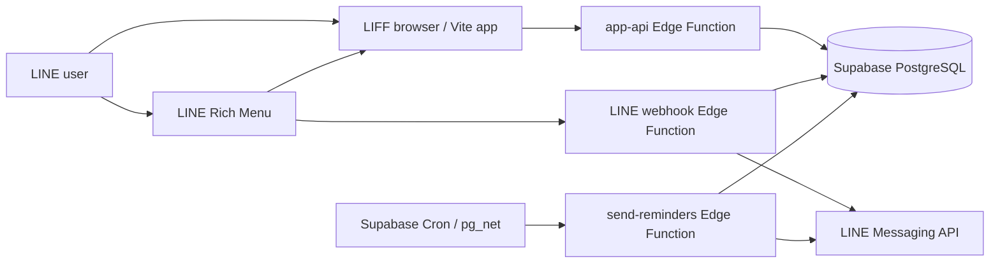
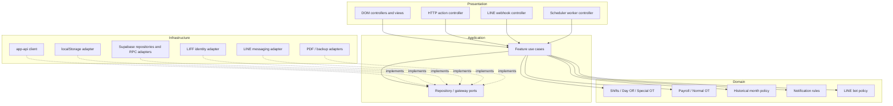

# NurseShift — Clean Architecture Audit & Incremental Refactoring Plan

วันที่ตรวจสอบ: 16 ตุลาคม 2026  
ขอบเขตเอกสาร: Stage 1 Architecture Audit และ Stage 2 Architecture Proposal เท่านั้น  
สถานะ: **ยังไม่มีการ Refactor Application Code, Database, Edge Function หรือ Production Configuration**

## 1. Executive Summary

NurseShift เป็นแอป Vite แบบ Vanilla JavaScript ไม่ใช่ React และ TypeScript ทั้งระบบตามที่อาจคาดจากโจทย์:

- Frontend ใช้ Vanilla JavaScript ES modules, HTML และ CSS
- Supabase Edge Functions ใช้ TypeScript ที่ entry points และ JavaScript ใน shared modules
- Backend ใช้ Supabase Edge Functions, PostgreSQL functions/views, RLS และ LINE APIs
- ไม่มี state-management framework, dependency-injection library, lint script หรือ type-check script
- มี Unit/Contract tests ด้วย Node test runner และมี Playwright E2E อยู่ใน Repository

ระบบไม่ได้เป็น monolith ทั้งหมด เพราะมี pure modules ที่แยกดีแล้ว เช่น `calculations.js`, `bulk-shifts.js`, `history.js`, `notification-scheduling.js` และ `line-delivery.js` แต่ boundary ระหว่าง Presentation, Application, Domain และ Infrastructure ยังไม่ชัดในไฟล์หลัก

ไฟล์ที่ควรจัดการก่อนคือ:

1. `src/app.js` — รวม UI state, rendering, event handlers, use-case orchestration, validation และ side effects
2. `supabase/functions/app-api/index.ts` — รวม HTTP, LINE authentication, profile provisioning, validation, queries, commands และ error mapping
3. `src/service.js` — รวม state normalization, local persistence, remote transport, cache และ LIFF initialization
4. `supabase/functions/line-webhook/index.ts` — รวม webhook controller, Supabase queries, LINE reply/link และ orchestration
5. `supabase/functions/send-reminders/index.ts` — รวม scheduler authentication, legacy/V2 orchestration, queries, retry และ delivery

ข้อเสนอหลักคือทำ Feature-Based Modular Clean Architecture แบบ incremental โดยไม่เปลี่ยน framework และไม่เพิ่ม dependency ก่อนจำเป็น การย้ายไป React หรือเปลี่ยน JavaScript ทั้งหมดเป็น TypeScript ควรเป็นโครงการแยก เพราะการทำพร้อม architecture refactor จะเพิ่ม regression surface โดยไม่ช่วยรักษาพฤติกรรมเดิม

## 2. Audit Method and Limits

Audit นี้ใช้การอ่าน source, imports, function boundaries, side-effect calls, Supabase queries, migrations และ test inventory เท่านั้น ไม่ได้แก้หรือรัน Production

ตัวเลข `Functions` และ `Branch indicators` ในตารางเป็น static heuristic จาก declaration/control-flow tokens ไม่ใช่ค่า cyclomatic complexity จาก compiler จึงใช้เปรียบเทียบขนาดเชิงสัมพัทธ์เท่านั้น

## 3. Current Architecture Assessment

### 3.1 Runtime topology



### 3.2 Existing layers in practice

| Concern | Current location | Assessment |
|---|---|---|
| Presentation | `index.html`, `src/app.js`, `src/styles.css` | Rendering and event handling exist, but `app.js` also performs application orchestration and validation |
| Browser application services | Mostly `src/app.js` | Use cases are embedded in DOM handlers and operate on global mutable state |
| Browser domain rules | `calculations.js`, `bulk-shifts.js`, `history.js`, parts of `data-transfer.js` | Mostly pure and testable; strongest existing seam |
| Browser infrastructure | `service.js`, PDF/download code in `app.js` | Local storage, HTTP, LIFF, caching and PDF are split across two files |
| HTTP controller | `app-api/index.ts` | Single action router with authentication, validation and persistence mixed in |
| Backend application/domain | `app-api/index.ts`, `_shared/*.js`, SQL RPCs | Some reusable modules exist; boundaries remain inconsistent |
| Backend infrastructure | Direct Supabase client and `fetch` calls inside handlers/workers | No repository or gateway boundary for most use cases |
| Persistence invariants | PostgreSQL schema, RLS, functions and views | Important correctness and concurrency behavior is correctly enforced close to data |

### 3.3 Positive foundations to preserve

- `src/calculations.js` is pure and already covers overlap de-duplication, Normal OT, Special OT and premiums.
- `src/bulk-shifts.js` isolates bulk-selection planning from DOM code.
- `src/history.js` isolates the three-calendar-month policy and month-scoped summaries.
- `_shared/notification-scheduling.js` and `_shared/line-delivery.js` isolate scheduling and LINE retry semantics.
- PostgreSQL RPCs protect atomic state replacement, version conflicts, job claims, leases and idempotency.
- RLS is enabled on user and operational tables.
- The public `app-api` contract is action-based and can be retained while internals move.
- Tests already cover payroll, Special OT, Day Off, history, LINE signature, bot privacy, scheduler behavior and performance contracts.

## 4. Large or Mixed-Responsibility Files

| Priority | File | Lines | Functions heuristic | Branch indicators | Direct coupling | Mixed responsibilities |
|---:|---|---:|---:|---:|---|---|
| 1 | `src/app.js` | 946 | 40 | 92 | About 206 DOM/event references and 17 module-level mutable variables | UI state, rendering, navigation, forms, validation, mutation orchestration, PDF/download, toast/loading and bootstrap |
| 2 | `supabase/functions/app-api/index.ts` | 417 | 19 | 75 | 19 `.from()`, 4 `.rpc()`, 2 `fetch()` | CORS, HTTP response mapping, LINE auth, profile provisioning/cache, query mapping, state validation, notification rules, LINE test push and account deletion |
| 3 | `src/service.js` | 224 | 14 | 29 | `fetch`, `localStorage`, LIFF globals | State normalization/migration, local repository, remote transport, request cache/deduplication, LIFF login and service selection |
| 4 | `supabase/functions/send-reminders/index.ts` | 176 | 8 | 20 | 4 `.from()`, 4 `.rpc()` plus LINE delivery | Scheduler auth, legacy worker, V2 worker, recovery, message composition, retry and response mapping |
| 5 | `supabase/functions/line-webhook/index.ts` | 144 | 10 | 23 | 9 `.from()`, 1 `.rpc()`, 2 LINE `fetch()` | HTTP webhook, signature guard, idempotency, repositories, authorization, bot orchestration, rich-menu linking and LINE replies |
| 6 | `src/data-transfer.js` | 121 | 6 | 12 | Browser-independent | CSV, backup schema validation, legacy migration and reminder display formatting |
| 7 | `_shared/line-bot.js` | 120 | 8 | 12 | Web Crypto and Flex schema | Signature verification, calendar range, payroll summary, privacy policy and presentation message building |
| 8 | `_shared/notification-scheduling.js` | 118 | 11 | 23 | Time-zone APIs only | Validation, recurrence, retry policy and status classification; cohesive enough to retain |
| 9 | `src/calculations.js` | 99 | 5 | 7 | Pure domain/date helpers | Cohesive payroll domain module; no urgent split needed |

`src/styles.css` มี 400 บรรทัด แต่เป็น presentation stylesheet ที่มี responsibility เดียว จึงไม่ใช่เป้าหมาย Clean Architecture ลำดับต้น แม้อาจแยกตาม screen ภายหลังเพื่อดูแลง่ายขึ้น

## 5. Detailed Audit Findings

### 5.1 Files with multiple responsibility types

#### `src/app.js`

- เก็บ global UI/application state เช่น selected date, active month, settings panel, bulk selections และ commit lock
- render ทุก screen และสร้าง HTML strings
- bind event handlers ทั้งหมดในฟังก์ชันเดียว
- validate form input และสร้าง domain entities โดยตรง
- mutate state, เรียก persistence, rollback conflict และ render ใหม่ใน `commit`
- สร้าง PDF, download files และอ่าน browser APIs

ผลกระทบ: การทดสอบ use case ต้องมี DOM และ global browser environment ทั้งที่กฎบางส่วนไม่เกี่ยวกับ UI

#### `supabase/functions/app-api/index.ts`

- เป็น composition root, controller, authentication service, validator, repository และ use-case handler ในไฟล์เดียว
- action routing ใช้ `if` ต่อเนื่อง ทำให้การเพิ่ม action เพิ่ม coupling ใน handler หลัก
- schema mapping snake_case ↔ camelCase อยู่ใกล้กับ controller
- profile provisioning และ cache เป็น infrastructure แต่ถูกเรียกตรงจาก request path
- state validation ขนาดใหญ่ผูกกับ persistence command

ผลกระทบ: การทดสอบ controller ต้อง mock Supabase และ LINE พร้อมกัน และการแก้ query อาจกระทบ HTTP contract

#### `src/service.js`

- `normalizeState` เป็น compatibility/domain migration concern
- `LocalService` เป็น local-storage adapter
- `RemoteService` เป็น HTTP adapter และ cache
- LIFF initialization/authentication เป็น external identity adapter
- `createService` เป็น composition/bootstrap logic

ผลกระทบ: boundary เดียวเปลี่ยนด้วยเหตุผลอย่างน้อยสี่ประเภท

#### LINE and notification handlers

- `line-webhook/index.ts` ทำ controller + database + LINE client + application orchestration
- `send-reminders/index.ts` ทำ auth + two worker modes + repository + message composer + retry orchestration

### 5.2 Business logic mixed with HTTP handlers

| Logic | Current location | Why it belongs elsewhere |
|---|---|---|
| Allowed history month and range | `app-api/index.ts` | Domain policy already has a frontend equivalent in `history.js` |
| State validation/invariants | `app-api/index.ts` | Application/domain validation should be callable without a Request object |
| Notification rule validation and next run | `app-api/index.ts` plus shared scheduler | Controller should delegate to a use case |
| Bot privacy decision | `_shared/line-bot.js`, called from webhook | Policy is domain/application authorization, not transport |
| Monthly payroll summary | `_shared/line-bot.js` | Canonical payroll logic should not belong to message presentation |
| Legacy/V2 delivery flow | `send-reminders/index.ts` | Worker controller should select a use case, not implement it |

### 5.3 Database queries inside controllers/workers

- `app-api/index.ts` directly reads/writes profiles, settings, shift types, shifts, Special OT, Day Off, financial items, reminders and notification rules.
- `line-webhook/index.ts` directly queries seven user/domain tables and updates webhook event state.
- `send-reminders/index.ts` directly queries legacy candidates/logs and invokes V2 claim/finish RPCs.

The issue is not that Supabase is used. The issue is that query shape, row mapping and orchestration are inseparable. Small function-based repositories are sufficient; one class per table would add unnecessary boilerplate.

### 5.4 Duplicate or drifting logic

| Rule or concern | Duplicate locations | Risk |
|---|---|---|
| Merge overlapping shift ranges | `src/calculations.js` and `_shared/line-bot.js` | Different row shapes can cause frontend/bot totals to drift |
| Payroll/month summary | `calculatePayroll`, `calculateMonthlyHistory`, `calculateBotMonthSummary` | Normal OT, Special OT, premiums or deductions could diverge |
| Bangkok month/date calculation | `date.js`, `history.js`, `app-api`, `line-bot`, `send-reminders`, SQL | Month boundaries and Buddhist-year display may disagree |
| Defaults 176/25/500 and premiums 200/300 | seed, app-api defaults, bot fallback and migrations | Changing one location may not update another |
| Reminder lead-time label | `data-transfer.js` and `send-reminders/index.ts` | User-facing text can differ |
| State shape compatibility | `service.normalizeState`, app-api response mapping, SQL JSON functions | Staged deployment compatibility can break |
| LINE push behavior | `app-api.pushTestNotification` and `_shared/line-delivery.js` | Timeout/retry/error semantics differ |
| JSON/error response helpers | each Edge Function | Inconsistent status and logging conventions |

Not every duplication should be removed. SQL defaults and constraints should remain as defense in depth. The canonical rule and database invariant may intentionally coexist, but they need parity tests.

### 5.5 Direct dependencies on Supabase and LINE

- Edge entry points construct concrete Supabase clients at module scope.
- Use-case code calls `.from()`/`.rpc()` directly rather than a narrow port.
- Browser service calls the single `app-api` endpoint directly using `fetch`.
- LIFF is accessed through `window.liff` in the same module that selects persistence mode.
- LINE reply/link calls are inside webhook orchestration.
- Test notification bypasses the shared LINE delivery adapter.

Recommended seams:

- `UserStateRepository`
- `HistoryRepository`
- `NotificationRepository`
- `WebhookEventRepository`
- `LineIdentityGateway`
- `LineMessagingGateway`
- `Clock`

These should be structural interfaces documented by TypeScript types or JSDoc/object shape. A DI container is unnecessary; pass dependencies into use-case factory functions.

### 5.6 Side effects that reduce testability

- `src/app.js` directly reads/writes DOM and global state in the same functions that orchestrate saves.
- `window.confirm`, `window.scrollTo`, downloads, PDF generation and LIFF close/reload are direct effects.
- `service.js` reads `localStorage`, `navigator.onLine`, `window.liff` and environment variables.
- Edge modules read `Deno.env` and create clients at import time.
- Edge code uses `new Date()`, `Date.now()`, `crypto.randomUUID()` and live `fetch` directly.
- Notification retry uses `Math.random()` in worker orchestration.
- Profile cache and request caches are module-level mutable state.

The first testability improvement should be injecting narrow functions (`now`, `random`, repositories, gateways), not introducing a general-purpose DI framework.

### 5.7 Database and security observations

- User isolation relies on authenticated server logic plus RLS; both must remain.
- Service-role Edge Functions can bypass RLS, so repositories must always require explicit `userId` and preserve current filters.
- Atomic RPCs are part of application correctness, not implementation detail:
  - state version conflict
  - notification job claim/lease/finish
  - webhook event idempotency
  - test-notification rate limiting
- Migrations contain historical redefinitions of `replace_user_state_v2`. These are migration history, not duplicate runtime code to consolidate by editing old migrations.
- Repository interfaces must wrap existing RPCs rather than replacing them with multi-query application transactions.

### 5.8 Refactor risks to Production

| Risk | Severity | Why | Required control |
|---|---|---|---|
| Payroll drift | Critical | User sees incorrect salary/OT estimate | Golden characterization fixtures shared across frontend, history and bot |
| Double-counted hours | Critical | Parallel shifts must count once | Cross-midnight/overlap contract tests before extraction |
| Special OT regression | Critical | Must count immediately and separately | Independent Special OT fixtures and migration compatibility tests |
| Authorization leakage | Critical | Service-role queries can expose another user | Repository contract requires `userId`; negative isolation tests |
| RLS/schema regression | Critical | Real user data and write access | No schema/RLS changes in refactor; migration diff must be empty |
| API contract break | High | Existing LIFF client depends on action/result/error shapes | Request/response snapshot tests per action |
| LINE signature/reply regression | High | Bot becomes unavailable or insecure | Raw-body signature and duplicate-event tests |
| Scheduler duplicate/missed delivery | High | User receives duplicate or no reminder | Fake clock, lease/idempotency/retry characterization tests |
| Time-zone boundary errors | High | Month/history/notification dates shift | Bangkok month-end/year-end fixtures |
| State-version conflict loop | High | Excess traffic and stale writes | Conflict response and single-refresh tests |
| Large frontend merge conflicts | Medium | `app.js` changes frequently | Extract one screen/controller at a time; avoid formatting whole file |
| Dual runtime module incompatibility | Medium | Browser and Deno import semantics differ | Prove shared pure module builds in both runtimes before consolidation |

## 6. Proposed Feature-Based Modular Clean Architecture

### 6.1 Design principles

1. Domain modules contain pure rules and know nothing about DOM, Supabase, LINE, LIFF or HTTP.
2. Application use cases orchestrate domain rules through small ports.
3. Presentation controllers translate DOM/HTTP/LINE events into use-case inputs and outputs.
4. Infrastructure adapters implement ports using Supabase, LINE, LIFF, localStorage, PDF and browser APIs.
5. Existing public API routes, action names, response payloads, SQL functions and RLS remain unchanged.
6. Introduce interfaces only at boundaries with real alternative implementations or test value.
7. Keep SQL concurrency/idempotency behavior in PostgreSQL.
8. Do not combine this work with React migration, design-system rewrite or database redesign.

### 6.2 Proposed folder structure

```text
shared/
  domain/
    time/
      bangkok-calendar.js
    shifts/
      shift-time.js
      overlap.js
    payroll/
      calculate-payroll.js
      payroll-types.js
    special-ot/
      special-ot.js
    day-off/
      day-off.js

src/
  app/
    bootstrap.js
    composition-root.js
    state-store.js
  modules/
    shifts/
      application/
        save-bulk-shifts.js
        remove-shift.js
      presentation/
        calendar-controller.js
        shift-sheet-controller.js
        calendar-view.js
    payroll/
      application/
        get-current-payroll.js
      presentation/
        home-view.js
        finance-view.js
    special-ot/
      application/
        save-special-ot.js
        remove-special-ot.js
      presentation/
        special-ot-controller.js
    day-off/
      application/
        plan-day-off.js
      presentation/
        day-off-view.js
    history/
      application/
        get-month-history.js
      presentation/
        history-controller.js
        history-view.js
    notifications/
      application/
        update-reminders.js
        test-notification.js
      presentation/
        notification-settings-controller.js
  infrastructure/
    api/
      app-api-client.js
      user-state-remote-repository.js
    local/
      user-state-local-repository.js
    line/
      liff-identity-gateway.js
    documents/
      pdf-exporter.js
      backup-exporter.js
  presentation/
    navigation-controller.js
    settings-controller.js
    ui-feedback.js

supabase/functions/
  app-api/
    index.ts
  line-webhook/
    index.ts
  send-reminders/
    index.ts
  _shared/
    http/
      response.ts
      errors.ts
      cors.ts
    application/
      bootstrap-user.ts
      replace-user-state.ts
      get-month-history.ts
      manage-notification-rule.ts
      process-line-event.ts
      deliver-notification.ts
    ports/
      repositories.ts
      line-gateway.ts
      clock.ts
    infrastructure/
      supabase/
        user-state-repository.ts
        history-repository.ts
        notification-repository.ts
        webhook-event-repository.ts
      line/
        line-identity-gateway.ts
        line-messaging-gateway.ts
    presentation/
      flex-message-builder.js
      notification-message-builder.js
    notification/
      scheduling.js
      expiration.js
```

Folder names are targets, not a requirement to create every file immediately. If a use case remains under roughly 40–60 lines and has no separate test seam, keep it together rather than creating empty layers.

### 6.3 Module ownership

| Module | Domain ownership | Application use cases | Infrastructure |
|---|---|---|---|
| Shifts | Duration, overlap, overnight ranges, premiums reference | Add/remove/bulk plan | State repository |
| Payroll & Normal OT | Worked-hour union, threshold, gross/net estimate | Current payroll, monthly summary | Settings/financial readers |
| Special OT | Whole-hour validation, immediate OT, no double count | Add/edit/remove Special OT | State repository |
| Day Off | Zero-hour rule, shift conflict policy | Add/remove/replace Day Off | State repository |
| Historical Data | Allowed 3 months, calendar-month scoping | Load selected month summary | History repository/cache |
| Notifications | Schedule validation, next run, retry classification | Create/cancel/deliver/recover | PostgreSQL RPC repository, LINE gateway, clock |
| LINE Bot | Allowed actions, privacy policy, authorized query orchestration | Process event and build reply model | Webhook event repository, user data repository, LINE gateway |

### 6.4 Target dependency diagram



Dependency direction is inward: Domain must never import Application, Presentation or Infrastructure.

### 6.5 Dependency injection without overengineering

Use factory/function parameters rather than a container:

```text
createReplaceUserState({ userStateRepository, clock })
createProcessLineEvent({ webhookEvents, userQueries, lineGateway, clock })
createDeliverNotifications({ notificationRepository, lineGateway, clock, random })
```

Keep concrete clients in composition roots only:

- browser: `src/app/composition-root.js`
- app API: `supabase/functions/app-api/index.ts`
- webhook: `supabase/functions/line-webhook/index.ts`
- worker: `supabase/functions/send-reminders/index.ts`

Do not introduce decorators, reflection, a DI framework, generic base repositories or event buses.

## 7. Module Extraction Priority

| Order | Extraction | Value | Complexity | Production risk |
|---:|---|---|---|---|
| 0 | Characterization contracts and shared fixtures | Creates safety net | Medium | Low |
| 1 | Canonical shift-time and payroll domain | Removes highest-risk duplication | Medium | High if tests are incomplete |
| 2 | Historical Data use case/repository | Small read-only vertical slice proving architecture | Low–Medium | Low |
| 3 | Shifts, Special OT and Day Off use cases | Removes mutation rules from DOM handlers | Medium | Medium |
| 4 | `app-api` controller/application/repositories | Shrinks largest backend mixed file while retaining route | High | High |
| 5 | LINE Bot controller/repositories/gateway | Separates privacy, queries and delivery | Medium–High | High |
| 6 | Notification worker application/repositories | Separates legacy/V2 paths without schedule change | High | Critical |
| 7 | Frontend presentation split from `app.js` | Improves maintainability after use cases stabilize | High | Medium |
| 8 | Optional TypeScript expansion | Improves static contracts | High | Medium; separate approval recommended |

Historical Data is the recommended first complete vertical slice after canonical domain extraction because it is read-only, already cached and has clear month-boundary tests.

## 8. Incremental Migration Steps

This section is a proposal only. No step has been executed.

### Step 0 — Freeze observable contracts

Add characterization tests before moving code:

- request/response/error fixtures for every `app-api` action
- state mapping fixture for camelCase ↔ snake_case
- payroll golden fixtures consumed by current payroll, history and bot calculations
- LINE webhook signature, duplicate event, privacy and unlinked-user fixtures
- notification legacy/V2 claim, retry, lease and recovery fixtures
- DOM-level tests for form input → use-case command without Browser E2E

Gate: tests pass against current implementation before any extraction.

### Step 1 — Shared time and payroll domain

1. Move pure shift-range union logic behind one canonical function.
2. Normalize browser and database row shapes through explicit mappers at boundaries.
3. Make current payroll, historical summary and bot summary call the canonical core.
4. Retain database defaults/check constraints and add parity tests.

Must preserve:

- standard hours remain user-configurable with default 176
- parallel/overlapping shift intervals count once
- overnight shifts remain supported
- Special OT counts immediately and is not part of normal worked-hour threshold
- existing evening/night premiums remain data-driven and unchanged

### Step 2 — Historical Data vertical slice

1. Extract `GetMonthHistory` use case.
2. Define `HistoryRepository.getMonth(userId, monthKey)`.
3. Keep three-month policy in Domain.
4. Keep RemoteService cache/deduplication behavior in infrastructure.
5. Preserve `month-history` request and response contract.

### Step 3 — Shifts, Special OT and Day Off

1. Extract command creation/validation from DOM submit handlers.
2. Keep UI-specific confirmation and loading in Presentation.
3. Keep state persistence through one `UserStateRepository.save` port.
4. Preserve current bulk conflict behavior and Special OT compatibility fallback.
5. Extract each module in a separate commit to limit rollback scope.

### Step 4 — app-api decomposition

1. Keep `Deno.serve` and existing `{ action, payload }` route in `index.ts`.
2. Extract CORS/JSON/error mapping without changing status codes.
3. Extract LINE identity verification gateway.
4. Extract profile provisioning and user-state repositories.
5. Extract action handlers into use cases.
6. Keep `replace_user_state_v2` and all RPC contracts unchanged.
7. Keep service-role credentials only in Infrastructure.

Target: `index.ts` becomes a composition root and thin controller, ideally under roughly 100–150 lines.

### Step 5 — LINE Bot

1. Keep raw-body signature verification before JSON parsing.
2. Extract event claim/complete operations to `WebhookEventRepository`.
3. Extract authorized user queries to a user-data repository.
4. Extract LINE reply/rich-menu operations to `LineMessagingGateway`.
5. Keep Flex rendering in Presentation and privacy policy in Domain/Application.
6. Preserve all action names, aliases, LIFF URLs and current reply text unless separately approved.

### Step 6 — Notifications

1. Characterize legacy and V2 modes independently.
2. Keep worker endpoint, cron frequency and authorization headers unchanged.
3. Extract message composition, repository calls and delivery orchestration.
4. Inject clock/random only into tests and use real implementations in composition root.
5. Keep PostgreSQL claim/lease/idempotency RPCs unchanged.
6. Do not enable new scheduler, cutover mode or paid provider.

### Step 7 — Frontend presentation

1. Move screen renderers without rewriting their HTML output.
2. Move related event handlers into screen controllers.
3. Replace free global variables with a small explicit app store object.
4. Keep `commit` semantics, optimistic mutation rollback, conflict refresh and request de-duplication.
5. Move PDF/download/backup effects to infrastructure adapters.
6. Leave CSS and visual behavior unchanged.

## 9. Testing Strategy

### 9.1 Characterization test matrix

| Area | Required baseline cases |
|---|---|
| Shifts | full hours, overnight, same-day overlap, cross-midnight overlap, parallel ranges counted once |
| Payroll | default/configured threshold, premiums, deductions, uncertainty range, confirmed cycle |
| Special OT | whole hours, immediate income, no normal-hour contribution, no double count, legacy fallback |
| Day Off | zero hours/income, shift conflict replacement, Special OT preserved |
| History | exactly current plus previous two months, year rollover, no mutation of old data |
| app-api | all action names, exact success/error shapes and HTTP status mapping |
| Authentication | missing/invalid LINE token, identity isolation, origin handling |
| LINE Bot | signature, idempotency, six actions, private salary, unlinked account, Rich Menu behavior |
| Notifications | legacy, V2, retry, 409 duplicate, lease, stale generation, recovery and opt-out |
| Persistence | state version increment/conflict and `updated_at` behavior |

### 9.2 Test execution after each approved extraction

Run only checks supported by the Repository:

1. `npm test`
2. `npm run build`
3. targeted contract tests for the module moved
4. Supabase migration dry-run only when a migration is intentionally introduced; none is expected for this refactor

Current limitations:

- no `lint` script exists
- no `typecheck` script or root `tsconfig.json` exists
- frontend is JavaScript, so TypeScript checking does not apply yet
- Browser E2E files exist, but they remain excluded unless the user explicitly re-authorizes E2E execution

Before claiming a future step complete, report unsupported checks honestly rather than implying they ran.

### 9.3 Contract preservation checks

- Snapshot action input/output envelopes rather than internal implementation.
- Use fake repositories/gateways for application tests.
- Keep a small number of adapter contract tests against Supabase types/query shapes.
- Compare canonical payroll results with current frontend, history and bot fixtures before removing old implementations.
- Require zero migration/schema diff for modules that should be code-only.

## 10. Risk-Control and Rollback Strategy

- One module per commit; no repository-wide rename/format pass.
- Keep public exports as compatibility facades during migration.
- Keep Edge Function route URLs and action names unchanged.
- Deploy no refactor automatically; Production remains approval-gated.
- Keep old function implementation callable until the new use case passes characterization tests.
- Do not edit historical migrations. Add a new migration only for an independently approved schema change.
- Preserve RLS policies and explicit `userId` filters in every repository adapter.
- Avoid feature flags unless two implementations must run side by side; prefer simple compatibility exports.
- Roll back by reverting the module-specific commit and redeploying the previous Edge Function version.

## 11. Estimated Scope and Complexity

Estimate assumes one engineer familiar with the current codebase, no React migration, no database redesign and no Production configuration change.

| Work package | Estimate | Complexity |
|---|---:|---|
| Characterization contracts and fixtures | 1.5–2.5 days | Medium |
| Shared shift/payroll domain consolidation | 1.5–2.5 days | Medium–High |
| Historical Data vertical slice | 0.5–1 day | Low–Medium |
| Shifts, Special OT and Day Off use cases | 1.5–2.5 days | Medium |
| app-api decomposition | 2–3 days | High |
| LINE Bot decomposition | 1–2 days | Medium–High |
| Notification worker decomposition | 2–3 days | High/Critical |
| Frontend presentation split | 2–4 days | High volume, medium runtime risk |
| Documentation and final regression | 1–2 days | Medium |

Estimated total: **13–22 focused engineering days**, delivered incrementally rather than as one release.

The estimate excludes:

- React migration
- full TypeScript migration
- API redesign
- database/schema redesign
- UI redesign
- Production rollout windows and manual LINE-client verification

## 12. Recommended Approval Sequence

If implementation is approved later, begin with:

1. Step 0 characterization contracts
2. Step 1 canonical shift/payroll domain
3. Step 2 Historical Data vertical slice

Stop and report after each step. Do not begin the next module without approval. This sequence proves the architecture using a read-only feature before touching authentication, writes, LINE delivery or scheduler behavior.

## 13. Audit Completion Checklist

- [x] Current architecture and runtime identified
- [x] Large/mixed-responsibility files measured
- [x] Business logic inside handlers identified
- [x] Direct database queries inventoried
- [x] Duplicate frontend/Edge logic identified
- [x] Supabase/LINE coupling identified
- [x] Side effects and testability risks identified
- [x] Production refactor risks assessed
- [x] Feature-based folder structure proposed
- [x] Dependency diagram provided
- [x] Module extraction priority provided
- [x] Incremental migration and testing strategy provided
- [x] Scope/complexity estimated
- [x] No Application Code, Database, Edge Function, Cron or Production Configuration changed
